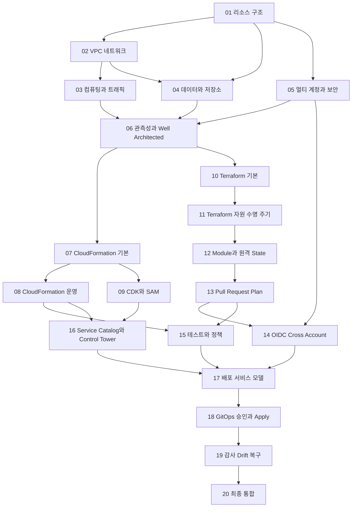

# AWS IaC 학습 지도

이 지도는 20개 과제가 어떤 역량을 쌓고 다음 단계에 무엇을 제공하는지 보여준다. 번호 순서를 기본 경로로 사용하되, 선행 과제의 완료 기준을 이미 증명할 수 있다면 해당 결과물을 제출하고 다음 과제로 이동할 수 있다.

## 전체 의존 관계



## 단계별 완성 그림

| 단계 | 질문 | 누적 결과물 |
| --- | --- | --- |
| AWS 아키텍처 | 무엇을 어디에 왜 배치하는가 | 멀티 계정 워크로드 아키텍처 |
| AWS 네이티브 IaC | AWS가 선언형 변경을 어떻게 실행하는가 | CloudFormation Stack, 조직 배포와 CDK/SAM 앱 |
| Terraform | 기존 자원과 State를 어떻게 안전하게 관리하는가 | Module, 원격 State와 변경 검증 Pipeline |
| 조직 플랫폼 | 표준을 어떻게 셀프서비스로 제공하는가 | 승인된 제품, 계정 공급과 정책 경계 |
| 자동 배포 서비스 | 요청부터 복구까지 어떻게 통제하는가 | API, 승인, 실행, 감사, Drift와 Runbook |

## 최종 시스템 흐름

```text
사용자 또는 서비스 카탈로그
  → 배포 요청과 입력 검증
  → Git 변경 및 Pull Request
  → CloudFormation Change Set 또는 Terraform Plan
  → 테스트와 Policy as Code
  → 환경별 승인
  → OIDC 기반 실행 역할 인수
  → Stack 배포 또는 Terraform Apply
  → 배포 후 검증과 감사 이벤트 저장
  → Drift 탐지와 복구 Runbook
```

최종 결과는 단일 IaC 도구를 사용하는 예제가 아니다. CloudFormation과 Terraform의 운영 모델을 비교하고, 조직의 표준과 승인 정책 아래에서 알맞은 실행기를 선택하는 배포 플랫폼이다.
